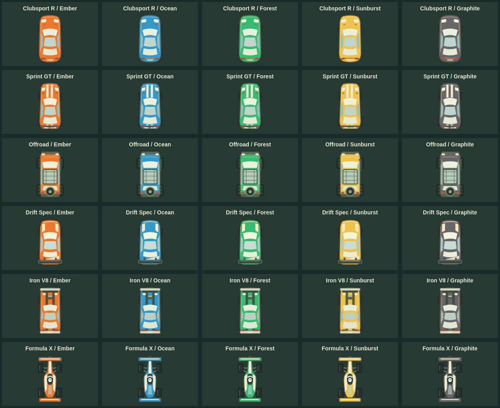
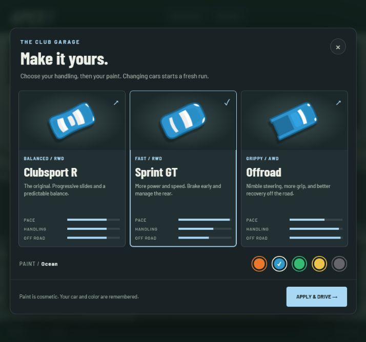
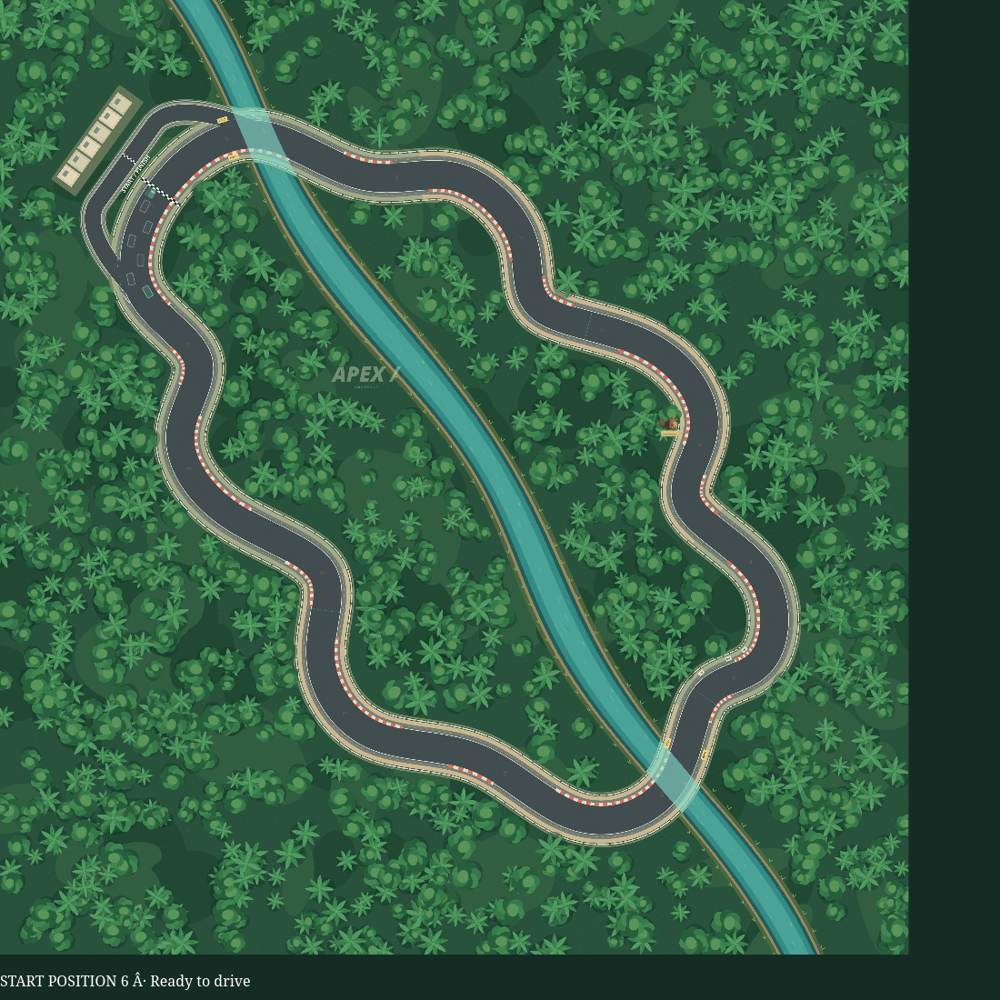
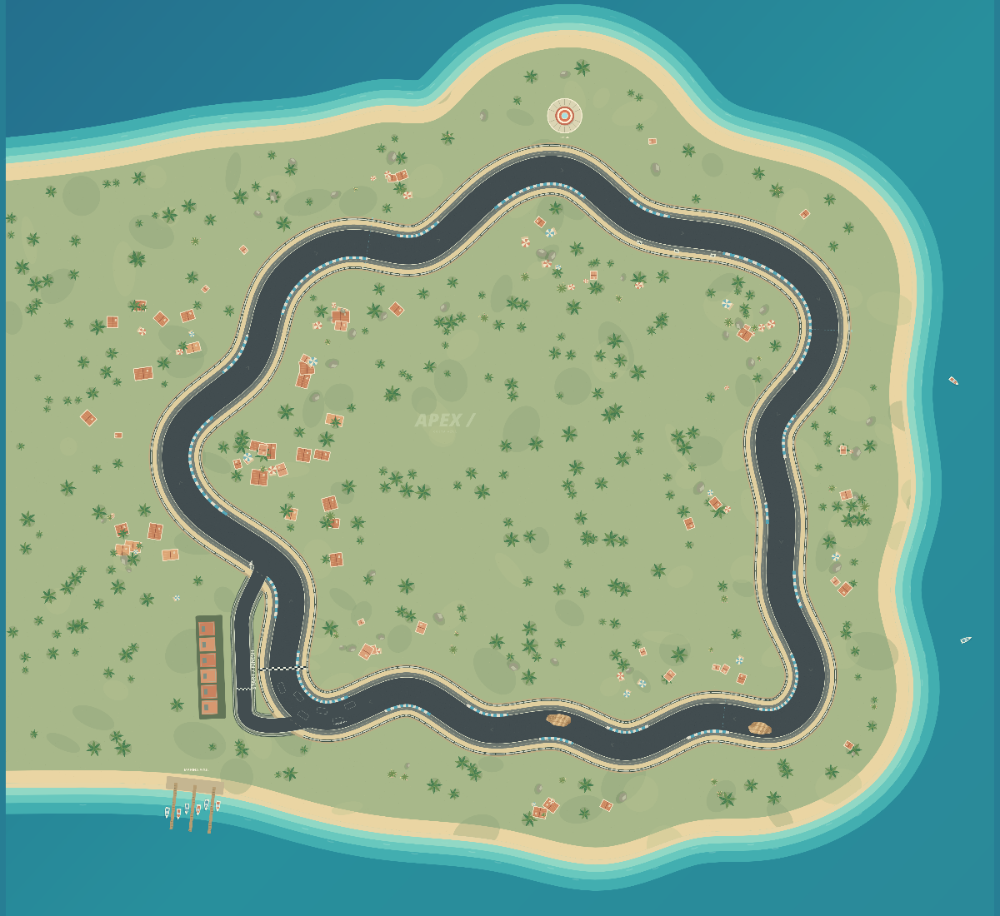
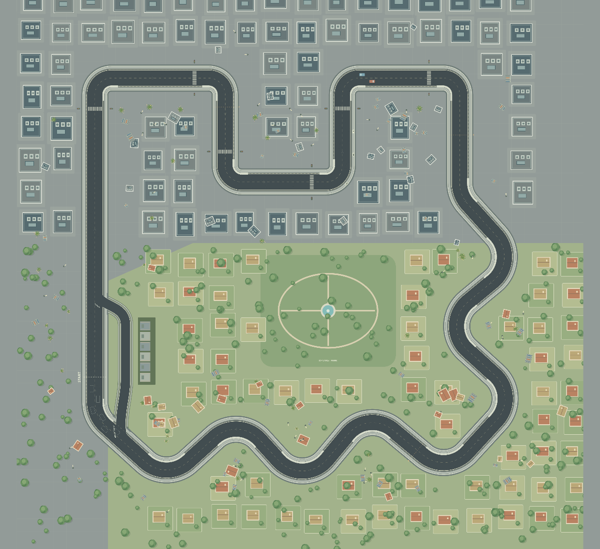
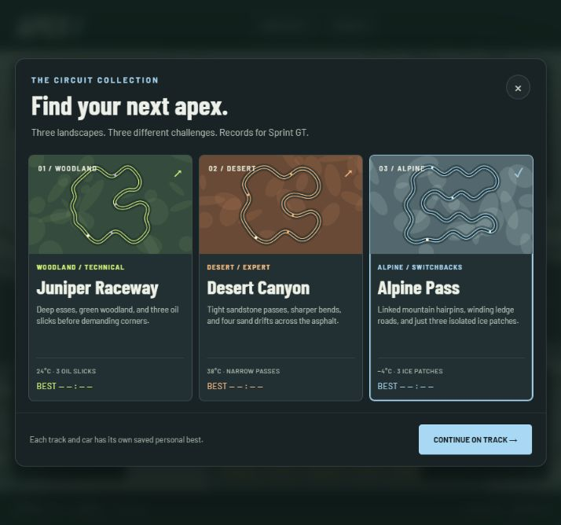

# APEX · The Circuit Collection

Pick a car, choose a circuit, and race. APEX is a top-down circuit racer with
eight tracks, six cars, time trials, lap ghosts, and a three-lap race against AI.

## The gallery

<p align="center">
  
  
</p>
<p align="center">
  
  
</p>
<p align="center">
  
  
</p>

## Play

Open [the game](https://orbitertoad.github.io/td-racing/) or run it locally:

```sh
python -m http.server 8000
```

Then visit [localhost:8000](http://localhost:8000). Use **WASD** or the arrow
keys to drive, **Space** for the handbrake, **N** to restart, and **Escape** or
**P** to pause.

In solo practice/time trials, press **B / Backspace**, gamepad **X**, or the
touch **↶ 5s** button to flash back up to five seconds. Using flashback marks the
track/car session as practice only, so its laps cannot set a personal best or
save a lap ghost. Club races do not offer flashback.

On the game mode screen, choose **Clear**, **Rain**, or **Snow**. Conditions stay
fixed for the session. Rain provides 72% of dry grip and snow 46%, reducing
traction for cornering, acceleration, and braking for both players and AI.
AI drivers slow their target pace accordingly. The race surface readout shows
the condition; reduced motion keeps the surface tint and freezes precipitation.

See [ASSETS.txt](ASSETS.txt) for asset credits and licenses.
