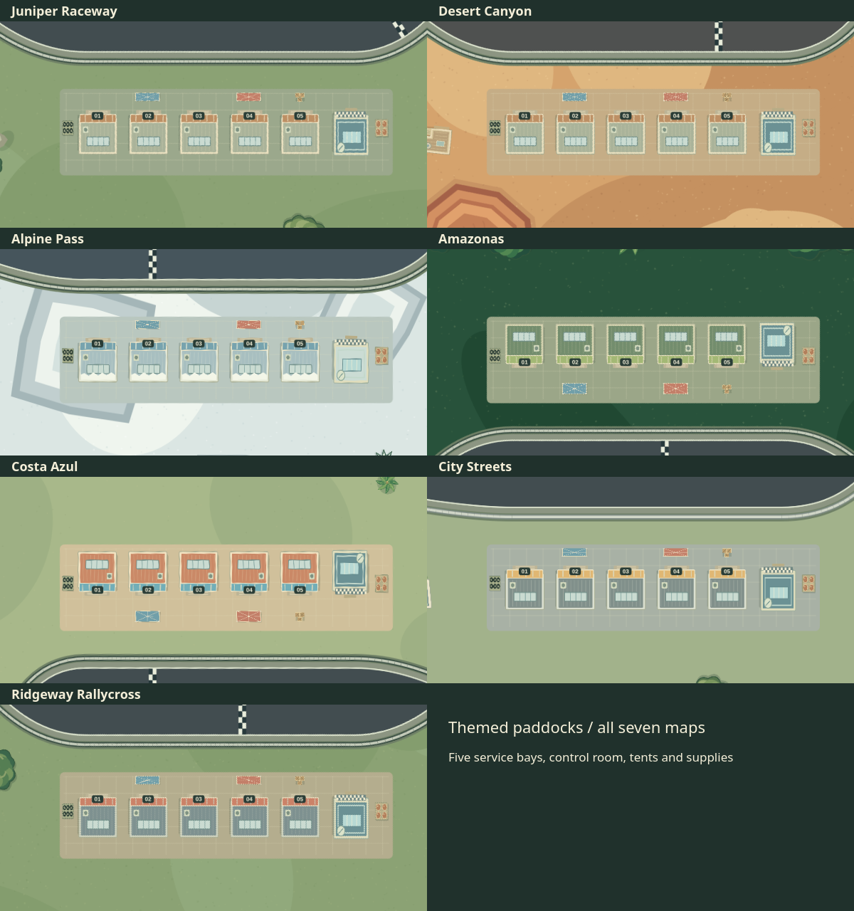

# APEX / The Circuit Collection

Start in the full-screen garage: choose a car and paint, then select a circuit
and game mode on separate screens. Press **Start driving** to load the circuit
and begin the countdown. Time trial supports every car and circuit; Club race
requires Juniper Raceway and the Clubsport R.
Your saved car, paint, and circuit are preselected on your next visit.

Large selection tiles and a featured preview keep the menus on one screen,
without scrolling. Use the arrow keys or Previous / Next buttons to browse;
on narrow screens these buttons replace the tile row. Enter confirms a focused
selection or continue button. Escape goes back one step during setup, preserving your choices.

During a session, open **Garage** or the track button in the header to change
selections. Escape or Back cancels these pickers and preserves your run.
Changing circuits resets the run, tire marks, and vehicle position.

## Circuits

### Juniper Raceway

The original technical esses and infield hairpin, with
three oil slicks just before demanding corners. Oil leaves the tires
slippery for about 1.15 seconds; grip recovers progressively after leaving.

### Desert Canyon

A distinct, tighter route with two narrow rock-wall passes,
dusty asphalt, heavy sand runoff, and four visible sand drifts on the road.
The drifts slow the car and leave space for an avoidance line.

### Alpine Pass

Three reversing mountain switchbacks linked by deep winding
traverses and an outside descent. Exactly three visible ice patches cover
a small portion of the road and reduce both steering and braking traction.
Snowy pine crowns and mountain contours are seen directly from above.

### Ridgeway Rallycross

Ridgeway Rallycross mixes asphalt and two flowing dirt sections. Dirt
reduces traction and adds rolling resistance; Offroad handles it better.

### Amazonas

Tight, linked jungle bends with no long straights. A diagonal
river crosses the road twice through shallow fords, with no bridges. Water
adds drag and reduces grip; slow down and splash through. Ripples and
floating leaves flow southeast, and the current gently nudges the car. Dense palms line
the banks. A trackside monkey throws coconuts at passing cars;
dodge the toss or briefly lose grip. Look for the COCONUTS warning board.

### Costa Azul

Short coastal bends, a fishing-village hairpin, beachside
esses and two avoidable sand drifts. A lighthouse overlooks the northern
headland; turquoise surf, fishing boats, terracotta roofs and palms frame
the circuit. The marina pit lane connects before and after the finish.

### City Streets

Six tight right-angle downtown corners lead into a broad,
winding suburb section. Office rooftops, crosswalks and traffic signals
give way to gardens, houses and Central Park. A service pit lane connects
before and after the start. This is an existing street network, with
sidewalk curbs, crosswalks and light two-way traffic. At most two other
cars are active; they cruise in their lanes and brake after a collision.

## Scenery

A shared pack of 48 original top-down SVG assets adds varied tree crowns,
palms, snowy pines, houses, cabins, offices, and warehouses. Paddocks have
five themed service bays, a control room, team canopies, tyre racks, fuel
stores, tool trolleys, water tanks, and supply crates, all inside the reserved
paddock footprint. New homes, greenhouses, cafés, garden beds, transporters,
grandstands, mossy rocks, and willows add variety outside the driving corridors.

Scenery shares one placement plan: buildings reserve their full plots first,
then small props and trees fill the remaining space without overlapping.
Ground details render below props, rooftops, and tree canopies. City park
paths and the fountain stay clear, as does the monkey’s perch in Amazonas.
Homes, cabins, village buildings, and cafés get reserved driveways or gravel
walks to the roadside verge where a clear route is available. Paddock garages
are grouped into blue and red team zones, each with matching transport and
service equipment.

The pack loads once into a reusable raster cache. Static scenery remains
baked into the world canvas, so the new detail does not add per-frame SVG
rendering. Regenerate the assets with `python3 tools/build-scenery-assets.py`.



Explore the full [scenery asset pack](preview-scenery-assets.png) and
[scenery placement across all maps](preview-scenery-placement.png).

Every landscape has denser scenery outside the barriers: woodland logs
and ferns, desert rock and cactus clusters, mountain pines and snowdrifts,
jungle flowers and fallen timber, rally team canopies and service vehicles,
and coastal villas, parasols and rock gardens.

Four sector times and comparisons against your best lap appear in the HUD.
Oil, sand, and ice have irregular outlines matching their physics areas.
The camera follows smoothly with no screen shake. Tire marks are batched
and track lookups use a spatial grid to keep sliding on gravel responsive.

## Pit lanes

Every circuit has an alternate paved route through its paddock. Follow PIT
ENTRY before the finish, drive past the garages, and rejoin at PIT EXIT.
Both openings are drivable; the pit lane has its own finish timing line.

## Club race

Click **Race AI · Juniper** in the bottom bar for a three-lap race against Alex,
Blair, and Casey. Everyone drives a Clubsport R on Juniper. The three opponents
have different fixed paces, brake ahead of bends, and slow around oil. Their pace
does not change to catch or wait for you. They share the player's driving
physics and collide with the player and one another.

The timing panel shows live positions, total race time, and the finishing result.
Opponent colors and name labels match the minimap dots. Cross the start line,
then complete three clean laps through all sector gates. Recovery invalidates
the current lap, so it must be replaced with a clean lap. Pause freezes the whole
race. **N / Restart** resets every driver and the countdown; selecting another
grid box before GO also resets the field. Click **Time trial** to leave the race.
Changing circuit or car also returns to time trial; changing paint preserves the
race. Ghost recording and personal bests remain available, with ghost rendering
hidden during club races so it is easy to identify the three opponents.

## Lap ghost

Your first clean lap records a ghost for that map and car, even if an older
personal best has no recorded path. Faster recorded laps replace the ghost;
your historic personal best stays separate. The cyan outline and GHOST label
remain visible when the cars overlap. A cyan minimap dot tracks the ghost
when it is outside the camera view. Its status and target time appear in
the timing panel. On a fresh run, the ghost and its live delta stay hidden
until you cross the start line. Ghosts save locally and replay on subsequent laps,
including through the pit lane. LIVE TO GHOST shows time gained (green) or
lost (red) at your current position along the recorded route.

## Garage

- **Clubsport R:** balanced rear-wheel drive, approximately 158 km/h.
- **Sprint GT:** more power, approximately 177 km/h, demands earlier braking.
- **Offroad:** all-wheel-drive trail car, more grip and less off-road drag,
  approximately 150 km/h.
- **Drift Spec:** rear-wheel-drive coupe with an angle kit, power oversteer and
  a rear wing, approximately 188 km/h. Lift and countersteer to catch a slide.
- **Formula X:** original open-wheel car with very high asphalt grip, speed-built
  downforce, strong brakes and an eight-speed display, approximately 337 km/h.
- **Iron V8:** heavy rear-wheel-drive muscle coupe, strong torque, slower steering
  and broad power slides, approximately 217 km/h.

All six cars have dedicated local artwork in every paint and separate lap ghosts
and personal-best records.
Paint: Ember, Ocean, Forest, Sunburst, or Graphite.
Changing car starts a fresh run and loads that car's record. Changing only
paint preserves the lap. Canceling either picker preserves your run.

The selected track, car, paint, and each track/car best time are saved
locally. Revised routes and hazards have separate records; earlier
versions' records remain under their old browser storage keys.

## Run locally

Open this folder in a terminal and run:

```sh
python -m http.server 8000
```

Then open [http://localhost:8000](http://localhost:8000).

## Driving and controls

Before driving, click a grid box to choose your starting position. Grid
boxes follow the local curve and face the direction of travel.

A 3–2–1–GO countdown holds the car before each fresh run. Choosing another
grid box restarts the countdown. Click Restart or press N to begin a fresh
run from your chosen grid spot while preserving saved times and ghosts.

- **W / Up:** accelerate
- **S / Down:** brake; hold at rest to reverse
- **A / D or Left / Right:** steer
- **Space:** handbrake (hold while steering to initiate a slide)
- **N:** quick restart with countdown
- **R:** recover to the nearest track point (invalidates the current lap)
- **Escape / P:** pause

Cross all three sector gates in order, then cross the start/finish line
in the forward direction to record a lap. Timing lines span the full width
between the barriers, including curbs and runoff.
The personal best is stored in this browser. Recovering invalidates the
current lap; crossing the finish line begins a fresh valid lap.
The game pauses when the window loses focus or is hidden.

## Technical details

Physics runs at 120 Hz. Canvas rendering uses p5.js. `main.js` registers the
p5 callbacks; game code lives in native ES modules in
`src/`. Page layout/style remains in `index.html`. No bundler is needed; serve
the folder over HTTP as shown above so the browser can load modules.

The module layout is:

| Area                                      | Files under `src/`                                              |
| ----------------------------------------- | --------------------------------------------------------------- |
| Startup and browser events                | `runtime.js`                                                    |
| Circuit/car definitions and shared state  | `config.js`, `state.js`                                         |
| Geometry, surfaces, vehicles, and traffic | `tracks.js`, `cars.js`, `traffic.js`                            |
| Physics, lap timing, and ghosts           | `physics.js`, `race.js`, `ghost.js`                             |
| World construction and scenery            | `world.js`, `scenery.js`, `terrain.js`, `jungle.js`, `coast.js` |
| Frame rendering, HUD, picker, and minimap | `renderer.js`, `ui.js`, `minimap.js`                            |
| Audio and math helpers                    | `audio.js`, `math.js`                                           |

`openSessionSetup()` in `src/ui.js` opens the Car → Circuit → Game mode wizard
from startup or an existing session, preserving the current car, paint, and
circuit as initial choices. Confirming the final screen starts a fresh session.

Modules import the stable simulation objects (such as `car` and `track`) by
name. Replaceable values (such as the selected circuit and canvas contexts)
live on `state`; read those properties when needed rather than taking a stale
copy. Importing modules does not start the game: only `main.js` registers the
p5 callbacks. The simulation harness imports the same modules directly.

p5.js and sprites are bundled locally. Google Fonts uses the internet;
the game remains playable when the fonts are unavailable.

See [ASSETS.txt](ASSETS.txt) for asset sources and licenses.

## Performance check

Run `npm run benchmark` after installing the development tools and Chromium.
The optional runner serves source on its own OS-assigned loopback port, uses
headless Chromium at 1280 × 900 with device scale 1, blocks external requests,
and writes `test-results/performance/report.json` plus a game-canvas screenshot
per repeat. It does not change the packaged game or add a timing gate to CI.
The same route workloads can be inspected in
[the performance tool](http://localhost:8000/tools/performance.html) with the local
server running.

The default run collects three repeats. Each repeat measures fresh browser
contexts for all seven circuits, then runs a complete route sweep on every
circuit with normal physics, a separate 4,200 tire-mark workload, and a Juniper
race with three AI opponents. Each scenario warms up for 30 frames and measures
240 frames, with two 120 Hz physics steps per rendered frame. Input and effect
randomness are seeded. The sweep spans warmup and measurement frames. Player velocity is set to
220 world units/s at each route placement before the two physics steps; this covers scenery and surfaces consistently,
but is not an autonomous clean lap. Opponents and City traffic advance through
their normal update paths. Sound is off and there is no saved ghost.

The runner verifies circuit selection, finite player physics, scenario coverage,
and three advancing AI opponents, and rejects JavaScript errors and missing
local responses. Existing simulation and browser tests cover driving, collisions,
race completion, and menus; the benchmark is an additional repeatable workload.

Startup records navigation-to-menu-ready and navigation-to-readable-game-canvas,
automatically exercising Car → Circuit → Mode → Start without user think time.
Start-to-canvas measures the three synchronous wizard handlers and the following
animation frame. Circuit-change timing includes geometry, world construction,
HUD/minimap setup and a canvas readback to flush queued raster work. Rendering
submission time excludes those readbacks and GPU completion; rAF intervals
include browser scheduling. The renderer's accumulator is bypassed in the route
workload to hold simulation work fixed when wall-clock scheduling varies.

Use environment variables to select frames, repeats, output and optional CPU
profiling. Keep profiling separate from timing comparisons:

```sh
BENCHMARK_OUTPUT=/tmp/apex-baseline.json npm run benchmark
BENCHMARK_PROFILE=1 BENCHMARK_REPEATS=1 BENCHMARK_FRAMES=60 \
  BENCHMARK_OUTPUT=/tmp/apex-profile.json npm run benchmark
```

### Recorded baseline

[Raw timing distributions](docs/performance-baseline.json) and
[a separate sampled CPU profile summary](docs/performance-profile.json) record
revision `374aee5` (production base `ba8cf3c`, including shared AI physics), with
a clean checkout, Node 24.22.2, Playwright 1.64.1 and headless Chromium
156.0.8078.4. The host was Linux x64, kernel 7.2.11, Intel i7-7700K (8 logical
CPUs), with 31.13 GiB RAM. WebGL reported ANGLE/SwiftShader; the Canvas 2D backend
was not independently pinned. The game canvas was 1280 × 748 at density 1.
This was a shared workstation: load average was 11.74/10.80/7.36 at the start
and 11.95/11.15/8.37 at the end. No benchmark-owned test suite ran concurrently.
Browser cache and storage were fresh per startup; OS file caches were warm and
localhost serving excludes internet latency. Fonts were blocked with other
external requests.

All values below are milliseconds. Startup/change columns are medians of three
samples; runtime columns are the median of the three per-run percentiles, not
percentiles pooled across runs. Each runtime distribution has 240 samples per
run. Raw data also includes p99, maxima, world size, and environment metadata.

| Circuit       | Menu ready | Start → canvas | Navigation → canvas | Circuit change |
| ------------- | ---------: | -------------: | ------------------: | -------------: |
| Juniper       |        806 |            845 |                1650 |            747 |
| Desert Canyon |        450 |            695 |                1116 |            665 |
| Alpine Pass   |        451 |            941 |                1355 |            898 |
| Ridgeway      |        466 |            568 |                1034 |            516 |
| Amazonas      |        464 |            984 |                1447 |            890 |
| Costa Azul    |        508 |           1184 |                1693 |           1144 |
| City Streets  |        537 |            795 |                1332 |            690 |

| Circuit / workload    | Render p50 | Render p95 | Two physics steps p95 | rAF interval p95 |
| --------------------- | ---------: | ---------: | --------------------: | ---------------: |
| Juniper / route       |        5.4 |        7.3 |                   0.2 |             16.8 |
| Juniper / skids       |        6.2 |       11.3 |                   0.3 |             16.7 |
| Juniper / ai          |        5.3 |        7.2 |                   0.5 |             16.7 |
| Desert Canyon / route |        4.9 |        8.9 |                   0.2 |             16.7 |
| Desert Canyon / skids |        5.5 |        9.9 |                   0.5 |             16.8 |
| Alpine Pass / route   |        5.3 |       10.9 |                   0.2 |             16.7 |
| Alpine Pass / skids   |        6.3 |       11.2 |                   0.5 |             16.7 |
| Ridgeway / route      |        5.6 |        9.8 |                   0.2 |             16.7 |
| Ridgeway / skids      |        5.8 |       10.5 |                   0.5 |             16.8 |
| Amazonas / route      |        5.8 |       12.2 |                   0.2 |             16.8 |
| Amazonas / skids      |        5.5 |        9.0 |                   0.4 |             16.8 |
| Costa Azul / route    |        5.5 |        9.5 |                   0.1 |             16.8 |
| Costa Azul / skids    |        5.7 |       10.3 |                   0.4 |             16.7 |
| City Streets / route  |        5.6 |       10.3 |                   0.2 |             16.8 |
| City Streets / skids  |        6.1 |       10.6 |                   0.4 |             16.8 |

Individual rAF p99 values reached 49.9 ms and the worst interval was 66.7 ms;
render submission reached 50.5 ms. The medians do not imply stall-free 60 FPS.
Captured canvases were inspected for the route, car, scenery, HUD and minimap;
all local browser checks passed.

The largest evidenced loading cost is synchronous circuit/world construction:
route circuit changes take roughly 516–1,144 ms, versus 0.1–0.2 ms p95 for two
player physics steps. In the separate 60-frame sampled run, `buildWorld` was the largest named
self-time entry (4,446 ms aggregated across the initial world and 15 circuit
changes), followed by `drawSkidmarks` (2,479 ms across ordinary and stress
workloads). Static `ribbon` painting accumulated 1,868 ms. Spatial lookup helpers
`cell`/`check` accumulated 1,901/1,571 ms across loading, explicit queries and
simulation; those totals should not be mistaken for player physics costs.
Canvas drawing dominates the active route workload relative to physics; nearest
road queries are recorded separately in the raw report. Profiling combines
loading and gameplay and attributes native canvas work to calling JavaScript
stacks, so aggregate self times are not per-frame costs.

Production physics, rendering and scenery are unchanged by this benchmark PR.
No speedup is claimed: there is no demonstrated isolated change warranting the
visual/behavior risk of altering world painting or AI physics. For a future
before/after comparison, use identical benchmark code, browser, machine,
viewport and frame counts, run timing passes without profiling, and compare
per-circuit distributions across repeats. Treat host contention, raster backend,
real input/camera behavior, audio, recorded ghosts, long races and other browsers
as limits of this baseline. Browser-matrix CI and keyboard behavior have their
own checks.

## Automated checks and deployment

Use Node.js 24 or later. Install the development tools and Chromium once:

```sh
npm ci
npx playwright install chromium
```

On Linux, use `npx playwright install --with-deps chromium` if browser system
libraries are missing.

Run the same checks as CI:

```sh
npm run format:check
npm run lint
npm test
npm audit --audit-level=high
npm run build
npm run test:browser
```

Run `npm run format` to apply Prettier formatting. `npm run check` runs formatting,
lint, simulation tests, the build, and browser tests in order; run the dependency
audit separately because it needs registry access. The pinned Prettier version,
[formatter config](.prettierrc.json), and [EditorConfig](.editorconfig) keep editor
and command-line formatting consistent. ESLint's Prettier compatibility config
turns off conflicting style rules.

ESLint checks project JavaScript and excludes bundled assets. `npm test` runs
the simulation assertions in `verify.mjs`, followed by deterministic collision
tests in `tests/collisions.test.mjs`. Collision coverage includes momentum
transfer, overlap separation, close passes, repeated contact stability, shared
player/AI dynamics, barriers, and recovery. Run it alone with
`node --test tests/collisions.test.mjs`. The browser test serves the packaged
site at `/td-racing/`, checks every circuit, changes cars, checks saved selections
and pause controls, and reports missing local assets or JavaScript errors.
Session tests cover canceling track/car/paint drafts, restoring pause state,
keeping club-race progress when changing paint, clearing held controls on focus
loss, and playing with malformed, blocked, or full browser storage.
External requests are blocked to verify the game works with bundled p5.js.
Set `PLAYWRIGHT_PORT` to use another local browser-test port when needed.
Browser failure reports are saved in `playwright-report/` and `test-results/`.

The [GitHub Actions workflow](.github/workflows/ci.yml) runs on every branch
push, every pull request, and manual runs. It reports five independent checks:

- **Formatting** checks Prettier formatting without changing files.
- **Lint** checks JavaScript with ESLint and allows no warnings.
- **Simulation tests** run the game physics and circuit assertions.
- **Dependency audit** blocks high and critical vulnerabilities, including in
  development tools, using `npm audit --audit-level=high`.
- **Build and browser tests** packages the site and tests that exact output in
  Chromium under `/td-racing/`, matching GitHub Pages hosting.

All jobs use Node.js 24, `npm ci`, the committed lockfile, and npm download
caching. New commits cancel obsolete pull request runs. Browser reports,
screenshots, and failure traces are available in the run's **Artifacts →
browser-diagnostics** for seven days, including reports for successful runs.

After all five checks pass on `master`, **Deploy to GitHub Pages** publishes
the tested `dist/` artifact without rebuilding it. Pull requests and other
branches run checks only. The deployment job alone receives Pages write and
OIDC permissions, and deployments run one at a time. `dist/` contains the game,
runtime assets, and credits; it is generated and is not committed.

To enable hosting:

1. Open the repository's **Settings → Pages** and select **GitHub Actions** as
   the source.
2. In **Settings → Environments → github-pages**, ensure deployment branch
   rules allow `master`.
3. Push or merge this workflow to `master`. Alternatively, select **CI and
   deploy → Run workflow → master** in the Actions tab.
4. Wait for all checks and deployment to pass. The deployment environment and
   Pages settings show the published URL:
   [orbitertoad.github.io/td-racing](https://orbitertoad.github.io/td-racing/).

Deployment uses GitHub's built-in token; no hosting credentials are required.
See [GitHub's Pages workflow documentation](https://docs.github.com/en/pages/getting-started-with-github-pages/using-custom-workflows-with-github-pages).

To enforce checks before merging, add a branch ruleset for `master`, require a
pull request, and require **Formatting**, **Lint**, **Simulation tests**, **Dependency audit**,
and **Build and browser tests**. Run the workflow once so these check names
appear in the ruleset picker. Avoid requiring the deployment check: it runs
after merging. Direct pushes remain possible unless your ruleset restricts them.

[Dependabot](.github/dependabot.yml) opens weekly update pull requests for npm
packages and GitHub Actions. Minor and patch development-tool updates are
grouped; major npm updates stay separate for review. Updates run the same CI
checks and require a merge before they reach production.

If deployment fails, check **Settings → Pages** uses GitHub Actions and the
`github-pages` environment allows `master`. If a check fails, open that job's
logs; for browser failures, download `browser-diagnostics` and open the HTML
report with `npx playwright show-report <path-to-playwright-report>`.
